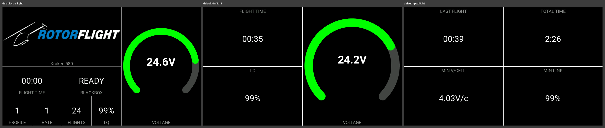
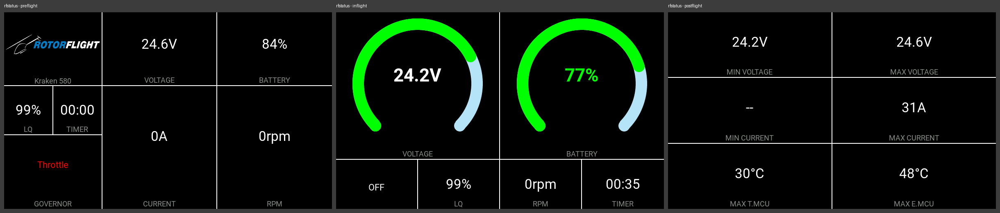
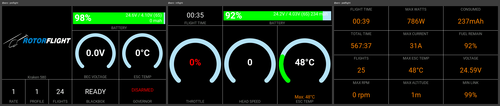
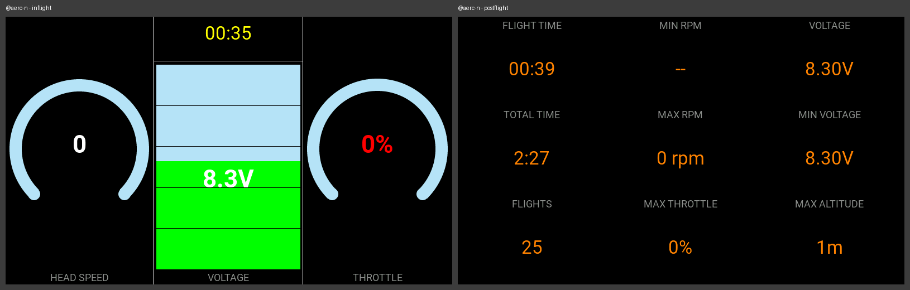
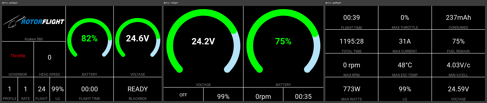
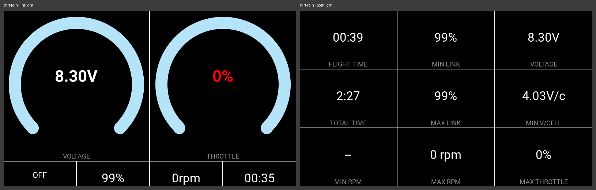
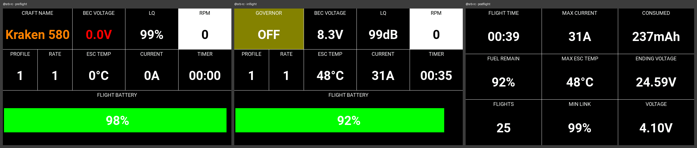
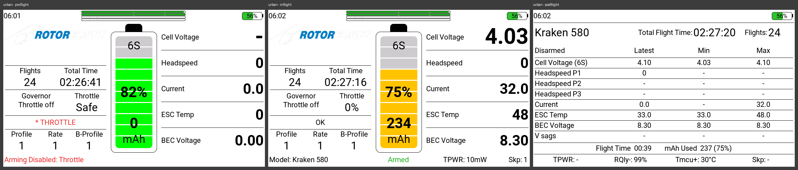

# Dashboard themes

A theme decides what the *RFSuite* dashboard widget draws. The suite ships eight of them, and
every theme draws three screens: one before the flight, one in flight and one after it. This page
shows each shipped theme on them, and says how to choose one.

## Choosing a theme

*System* → *Settings* → *Dashboard* → *Design*. The theme chosen there is the one every model
shows. A different theme for the inflight or the postflight screen alone, and a theme of a
model's own, are switched on on the same page; [Design](../pages/settings/dashboard/theme.md)
describes every row of it.

A theme's own settings, such as the voltage range its gauges span, are under
*System* → *Settings* → *Dashboard* → *Settings*, one tile per theme
([Settings](../pages/settings/dashboard/settings.md)).

## What every theme has in common

- **The screen follows the flight, not a switch.** The widget shows the preflight screen until
  the model is armed and flying — the governor active or the throttle above its threshold — then
  the inflight screen, and after disarming the postflight screen with the numbers of the flight that
  just ended. A model armed on the bench that never spools up goes back to the preflight screen
  and shows no postflight screen, because there was no flight. The exact rules are in
  [developer/dashboard-themes.md](../developer/dashboard-themes.md#what-puts-the-widget-into-each-phase).
- **Before the first screen, a connecting screen.** Until the flight controller answers, battery
  and link telemetry have arrived and the suite has finished its connection tasks, every theme shows
  *Connecting FBL...* with a line saying what it is still waiting for, in place of its preflight
  screen.

## The shipped themes

The pictures were taken on a TX16S MK3 (800x480) during a short simulated flight of a 6S
electric helicopter, left to right before, during and after the flight; for the two nitro themes,
during and after it. Some values in them come
from the simulation rather than from a model in the air: the head speed reads 0 throughout, and
*Total time* is the flight controller's own lifetime counter, which is why it differs between the
pictures.

### Default

The theme a new installation starts with. Before the flight: the model picture and name, the
flight timer, the blackbox state, the PID and rate profile, the flight count, the link quality
and a voltage gauge. In flight it is reduced to the flight time, the link quality and the voltage
gauge; after the flight it shows the last flight's time, the total time, the lowest voltage per
cell and the lowest link quality.

### RF Status

Telemetry first. Before the flight: the model picture, the pack voltage, the battery percentage,
the link quality, the timer, the governor state, the current and the head speed. In flight: a
voltage gauge and a battery gauge above the governor state, the link quality, the head speed and
the timer. After the flight: the lowest and highest voltage and current, and the highest
temperature of the flight controller and of the ESC.

### @AERC

Built around a battery bar that carries the percentage, the pack voltage, the voltage per cell,
the cell count and the capacity used. Before the flight: the model picture, the battery bar, the
BEC voltage and the ESC temperature as gauges, the rate and PID profile, the flight count, the
blackbox state and the governor state. In flight: the flight time, the battery bar, and the
throttle, the head speed and the ESC temperature as gauges, the last with its highest value of
the flight. After the flight, twelve numbers: flight time, highest power, capacity used, total
time, highest current, fuel left, flight count, highest ESC temperature, voltage, highest head
speed, highest altitude and lowest link quality.

### @AERC Nitro

The @AERC layout for a nitro helicopter: it shows the BEC voltage where @AERC shows the flight
pack. Before the flight: the throttle, the head
speed, the blackbox state, the governor state, the model picture, the rate and PID profile, the
flight count and a vertical BEC voltage bar. In flight: the head speed and the throttle as
gauges either side of the flight time and the voltage bar. After the flight: flight time, lowest
and highest head speed, voltage and lowest voltage, total time, flight count, highest throttle
and highest altitude.

### @RT-RC

Large arc gauges. Before the flight: the model picture, the governor state, the head speed, the
battery percentage and the pack voltage as gauges, the PID and rate profile, the flight count,
the link quality, the flight time and the blackbox state. In flight: the voltage and battery
gauges above a row with the governor state, the link quality, the head speed and the flight
time. After the flight, twelve numbers: flight time, highest throttle, capacity used, total time,
highest current, fuel left, highest head speed, highest ESC temperature, lowest voltage per cell,
highest power, link quality and voltage.

### @RT-RC Nitro

The @RT-RC layout for a nitro helicopter, on the BEC voltage instead of a flight pack. Before the
flight: the model picture, the governor state, the head speed, the PID and rate profile, the
flight count, the link quality, the flight time, the throttle and the BEC voltage as gauges, and
the blackbox state. In flight: the BEC voltage and the throttle as gauges above the governor
state, the link quality, the head speed and the flight time. After the flight: flight time,
lowest and highest link quality, voltage, total time, lowest voltage per cell, lowest and highest
head speed and highest throttle.

### @SRB-RC

A grid of large numbers over a full-width battery bar. Before the flight: the craft name, the
BEC voltage, the link quality, the head speed, the PID and rate profile, the ESC temperature, the
current and the timer. In flight the craft name gives way to the governor state, with the rest
in the same places. After the flight: flight time, highest current, capacity used, fuel left,
highest ESC temperature, voltage at the end of the flight, flight count, lowest link quality and
voltage.

### Urban

A theme drawn from code rather than from a grid of boxes, which takes the whole screen in
fullscreen mode. It has a page of its own: [Urban theme](urban-theme.md).

## Related

- [Design](../pages/settings/dashboard/theme.md) — choosing the theme, per flight phase and per
  model.
- [User themes](user-themes.md) — copying a shipped theme and changing what it shows.
- [developer/dashboard-themes.md](../developer/dashboard-themes.md) — how a theme is built.

*Documented against RFSuite 0.2.0.*
